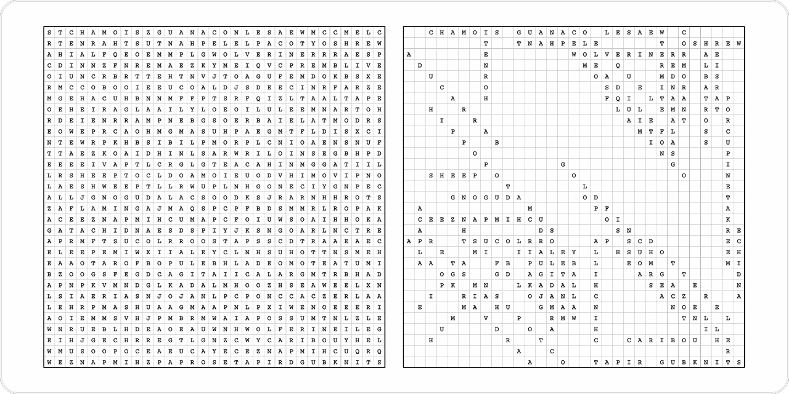

<h1 align="center">wordsearch</h1>

<p align="center">Word search puzzles from your own word lists, in the terminal or as a PDF.</p>

<p align="center">
  <a href="docs/example.pdf"><b>Example PDF</b></a> &nbsp;·&nbsp;
  <a href="#quick-start">Quick start</a> &nbsp;·&nbsp;
  <a href="#documents">Documents</a> &nbsp;·&nbsp;
  <a href="#how-it-works">How it works</a>
</p>

<p align="center">
  
</p>

wordsearch makes **word search puzzles** from a list of words. You can also give
it a second list of **hidden** words: they go into the puzzle like the real
answers but are left out of the key, so the solver has to pick the right word
out of several near-misses.

## Quick start

With [uv](https://docs.astral.sh/uv/):

```sh
uv run wordsearch words.txt                            # a puzzle, in the terminal
uv run wordsearch words.txt hidden.txt                 # with hidden near-misses
uv run wordsearch -l 8 -p puzzle.pdf words.txt hidden.txt   # harder, and a PDF
uv run wordsearch -h                                   # every option
```

`-l` sets how many directions words run in, from 1 (left to right only) to 8.
See [Using wordsearch](docs/usage.md) for more.

## Documents

| Document | What's in it |
| -------- | ------------ |
| [Using wordsearch](docs/usage.md) | Word lists, the options and levels, what it prints, the PDF, and an example |
| [Development](docs/development.md) | Working on it, using `Grid` from Python, and how a puzzle is made |
| [Example PDF](docs/example.pdf) | A puzzle with its key, and its solution, ready to print |

## How it works

The words, hidden ones included, are placed longest first at random positions,
in the directions the level allows, crossing where their letters agree; the
rest of the grid is filled with random letters. It is one file,
`src/wordsearch/main.py`, and draws the PDF with
[ReportLab](https://pypi.org/project/reportlab/).

---

<p align="center"><sub>Part of <a href="https://daleobrien.github.io/#mazes">Mazes &amp; Puzzles</a> &nbsp;·&nbsp; more at <a href="https://daleobrien.github.io">daleobrien.github.io</a></sub></p>
